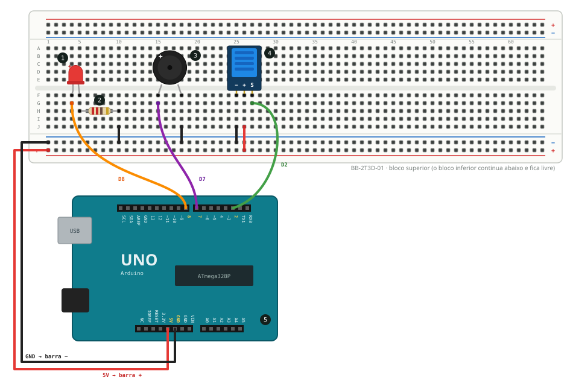
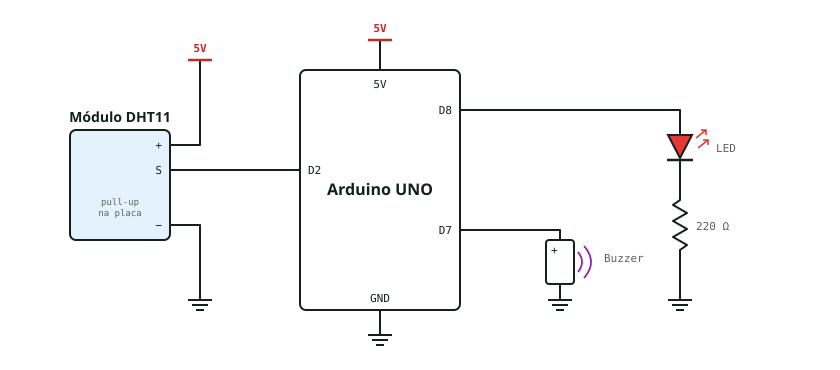
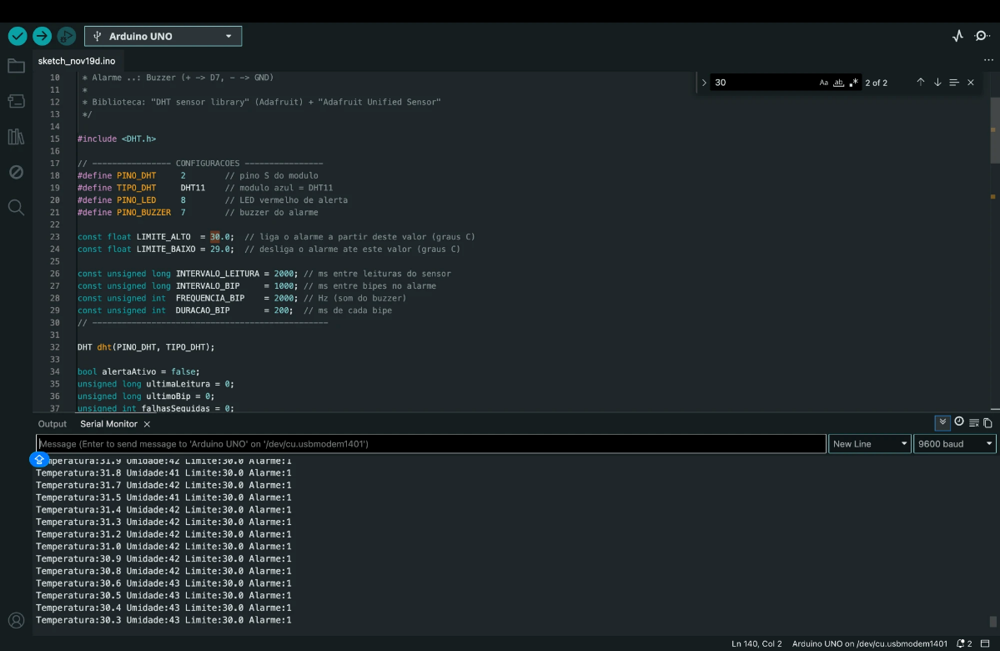
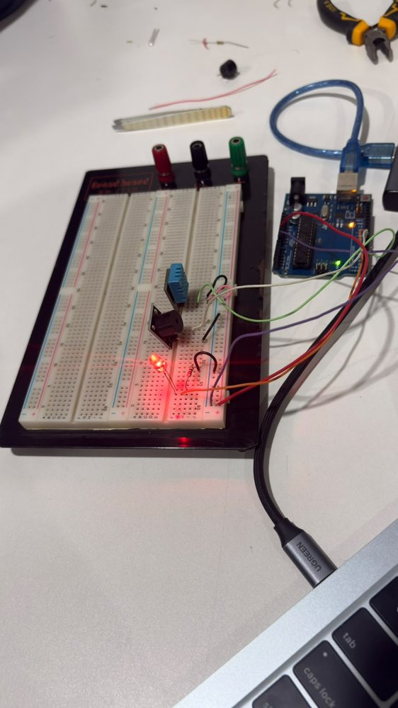
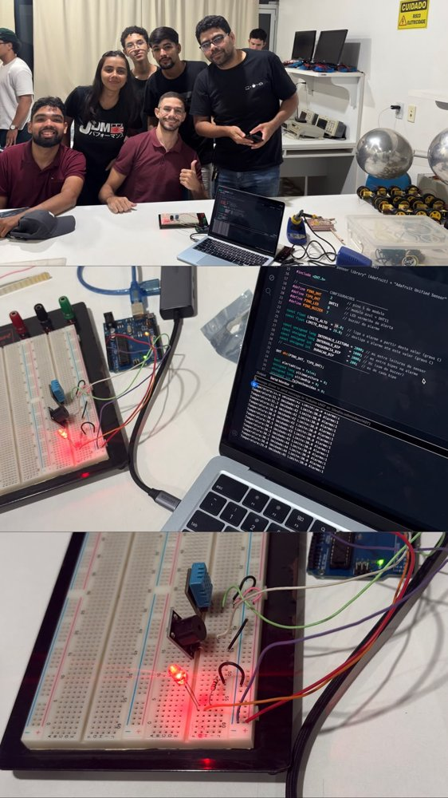

# Monitor de Clima com Arduino – Relatório Individual

Relatório individual de extensão sobre o projeto **Monitor de Clima com Arduino: protótipo de IoT para alerta de temperatura e umidade**, desenvolvido em grupo no Centro Universitário FACIMP Wyden (Imperatriz/MA). Este repositório reúne o relatório, o código, os diagramas e a simulação do protótipo.


## Sobre o projeto

Um Arduino UNO lê temperatura e umidade com um sensor DHT11, envia as leituras para o computador pela USB e dispara um alarme quando a temperatura passa do limite: um LED vermelho acende e um buzzer apita uma vez por segundo.

- Lê temperatura e umidade a cada 2 segundos.
- Envia os dados no formato `Nome:valor`, que aparece como texto no **Monitor Serial** e como gráfico no **Plotter Serial** da Arduino IDE:

  ```
  Temperatura:23.0 Umidade:55 Limite:22.0 Alarme:1
  ```

- O alarme liga ao atingir o limite e só desliga 1 °C abaixo. Essa folga (histerese) evita que o LED e o buzzer fiquem liga-desliga quando a temperatura oscila. O limite fica no bloco `CONFIGURACOES` do código (na demonstração, foi usado 30 °C).
- Ao ligar, o LED pisca e o buzzer dá dois bipes curtos, para testar a montagem.
- Se o sensor não responder, o programa mostra no Monitor Serial a causa provável.

## Componentes

| Qtd | Componente                                  |
| --- | ------------------------------------------- |
| 1   | Arduino UNO + cabo USB                      |
| 1   | Protoboard BB-2T3D-01 (1580 pontos)         |
| 1   | Módulo DHT11 de 3 pinos (marcado `− + S`)   |
| 1   | Buzzer 5 V                                  |
| 1   | LED vermelho 5 mm                           |
| 1   | Resistor 220 Ω                              |
| ~10 | Jumpers                                     |

## Ligações

| Componente | Pino            | Liga em              |
| ---------- | --------------- | -------------------- |
| DHT11      | `−`             | GND                  |
| DHT11      | `+`             | 5V                   |
| DHT11      | `S`             | pino digital **2**   |
| LED        | perna longa (+) | pino digital **8**   |
| LED        | perna curta (−) | resistor 220 Ω → GND |
| Buzzer     | `+`             | pino digital **7**   |
| Buzzer     | `−`             | GND                  |

Na protoboard, cada pino e o fio que liga nele precisam estar **na mesma coluna e do mesmo lado do canal central**: as metades A–E e F–J não se conectam.

### Diagrama de montagem



### Esquema elétrico



## Como rodar

1. Instale a [Arduino IDE 2](https://www.arduino.cc/en/software).
2. Em **Ferramentas → Gerenciar Bibliotecas**, instale **DHT sensor library** (Adafruit) e aceite instalar junto a **Adafruit Unified Sensor**.
3. Abra `MonitorClima/MonitorClima.ino`.
4. Selecione **Ferramentas → Placa → Arduino Uno** e a porta do Arduino.
5. Clique em **Carregar**.
6. Abra o **Monitor Serial** em **9600 baud** ou o **Plotter Serial** para ver o gráfico.

## Simulação no Wokwi

A pasta [`wokwi/`](wokwi) tem o mesmo projeto pronto para o simulador [Wokwi](https://wokwi.com). Crie um projeto novo de Arduino UNO e cole o conteúdo de `sketch.ino`, `diagram.json` e `libraries.txt` nas abas de mesmo nome. Como o Wokwi não tem o DHT11, a simulação usa o DHT22, que funciona igual. Com a simulação rodando, clique no sensor para mudar a temperatura e disparar o alarme.

## Registro fotográfico

<table>
  <tr>
    <td align="center"><br><sub>Equipe na apresentação do protótipo</sub></td>
    <td align="center"><br><sub>Leituras no Monitor Serial com o alarme ativo</sub></td>
  </tr>
  <tr>
    <td align="center"><br><sub>Protótipo com o alarme acionado (LED aceso)</sub></td>
    <td align="center"><br><sub>Equipe, protótipo e leituras no computador</sub></td>
  </tr>
</table>

## Estrutura

```
relatorio/                       relatório individual (.pdf e .docx)
MonitorClima/MonitorClima.ino    código para o Arduino UNO
wokwi/                           versão para o simulador Wokwi
docs/                            diagramas e fotos
README.md                        este arquivo
```

## Autoria

- **Relatório individual:** Rebeka Silva Sampaio
- **Professor orientador:** João Lucas
- **Instituição:** Centro Universitário FACIMP Wyden – Imperatriz/MA
- **Ano:** 2026
